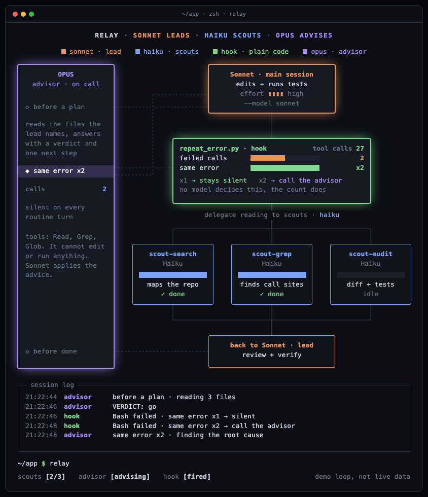
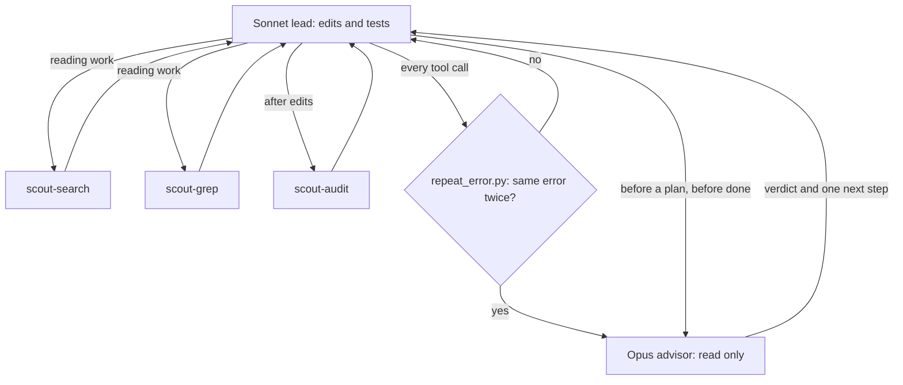

# relay

A Claude Code plugin that splits one task across three models by cost.

- **Sonnet leads.** It writes every edit and runs the tests.
- **Haiku scouts read.** Three cheap agents map the repo, find call sites and check the diff, in parallel.
- **Opus advises.** One read only agent, called at three fixed moments. It never writes code.
- **A hook watches for repeated errors.** Plain code, no model. On the second matching error it tells the lead to stop retrying and call the advisor.



## Install

Inside Claude Code:

```
/plugin marketplace add stavthal/claude-plugins
/plugin install relay@stavthal
```

## Use

Start a session on Sonnet, then turn on the lead rules:

```
claude --model sonnet --effort high
/relay:lead
```

Then give it the task as usual.

## How it works



### What is inside

| Piece | File | Model | Tools |
| --- | --- | --- | --- |
| Lead rules | `skills/lead/SKILL.md` | your session model | all |
| Advisor | `agents/advisor.md` | Opus | Read, Grep, Glob |
| Search scout | `agents/scout-search.md` | Haiku | Read, Grep, Glob |
| Grep scout | `agents/scout-grep.md` | Haiku | Read, Grep, Glob |
| Audit scout | `agents/scout-audit.md` | Haiku | Read, Grep, Glob, Bash |
| Repeat error hook | `scripts/repeat_error.py` | none | none |

### The repeat error hook, with a real example

The hook runs after every tool call. It only acts on failed ones.

1. The lead runs `npm test`. It fails with `TypeError: user is undefined at service.ts:42`.
2. The hook lowercases the error, turns every number into `N`, and hashes it with the tool name. Count for that hash: `1`. It stays silent.
3. The lead changes something and runs `npm test` again. Same error, now at `service.ts:47`.
4. The line number differs, but numbers were turned into `N`, so the hash matches. Count: `2`.
5. The hook adds this to the lead's context:
   `relay: the same Bash error has now come back 2 times. Stop retrying. Call the relay:advisor agent with the exact error and the files involved, then apply its advice.`

Counts are kept per session in the system temp folder, in `relay-errors-<session id>.json`. The read and write happen under a file lock, because parallel tool calls run the hook at the same moment.

## Limits

- The three advisor moments depend on the lead following the rules in the skill. Only the repeated error trigger is enforced by code.
- The hook counts any failed tool call, including ones made by the scouts.
- It needs `python3` on the PATH. The file lock uses `fcntl`, so it runs on macOS and Linux, not on native Windows.

## The animated graphic

`graphic/index.html` is a self contained animation of the flow, with no dependencies. Open it in a browser. It is a demo loop, not live data.

## Run from a checkout

Without installing, from any repo:

```
/path/to/claude-plugins/plugins/relay/bin/relay
```

This starts Claude Code with the plugin loaded, on Sonnet, with the lead rules already applied.

## License

MIT
